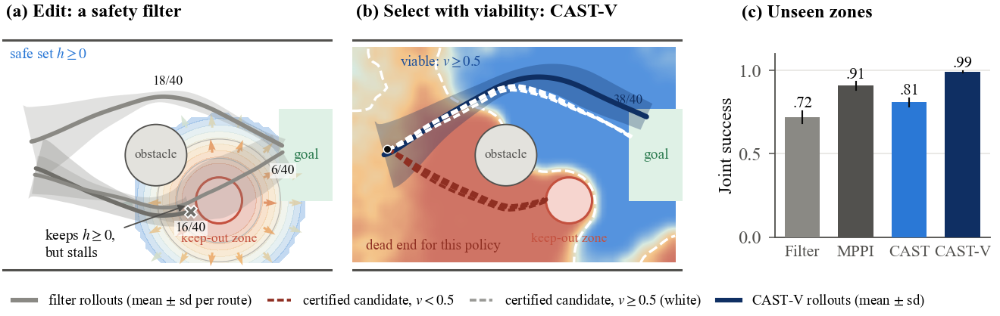
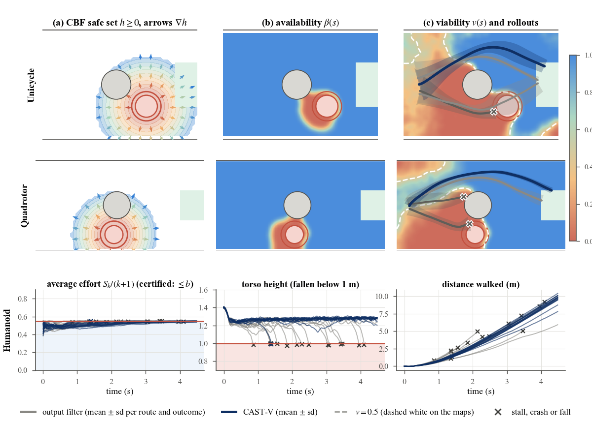
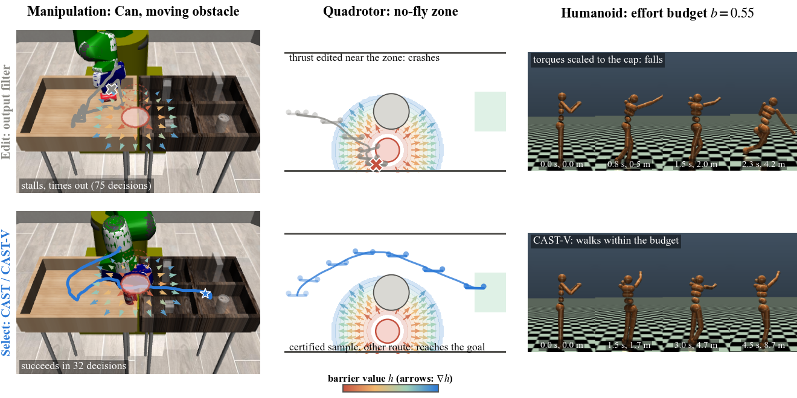
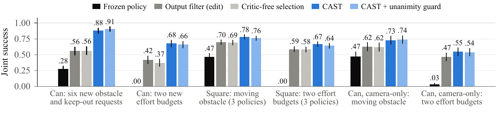
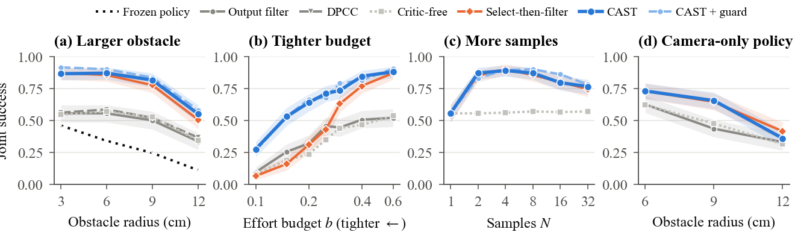
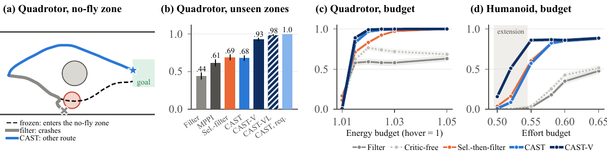

::: {.authors}
Angelo Moroncelli · Loris Roveda
:::

::: {.affil}
SUPSI-IDSIA, USI, Lugano, Switzerland · Politecnico di Milano, Milan, Italy
:::

::: {.venue}
L4DC 2027
:::

```{=html}
<div class="video-wrap">
<video controls preload="metadata" playsinline poster="media/poster.jpg">
  <source src="media/cast_video.mp4" type="video/mp4">
  Your browser does not support the video tag.
</video>
</div>
```

::: {.question}
**Being safe now does not mean remaining capable of acting safely.**
Can we enforce a new constraint while preserving not only immediate safety and task performance, but also the frozen
generative policy's future ability to act safely?
:::

::: {.answer}
CAST moves safety filtering from correcting individual actions toward selecting behaviours that preserve future safe control authority.
:::

## Method

A diffusion policy turns random noise into a short sequence of future actions, an *action chunk*, so each observation yields a
distribution of plausible chunks. At run time the robot meets a constraint its demonstrations never contained, a *request*: a
person reaching across the table, a keep-out volume, a limit on motor effort. A safety filter edits the policy's action to satisfy
it; the edit ignores the task, and a large edit can leave the policy where it cannot continue.

{fig-align="center"}

### CAST: certify, then select

At every decision, with the policy frozen:

1. **Sample.** Draw $N$ latents and decode $N$ chunks $a_1,\dots,a_N$ in one batch (we use $N=8$).
2. **Certify.** Keep the chunks for which a discrete-time barrier condition holds over the chunk and a braking/holding backup,
   with margins for predictor and forecast errors: $h(p_{kT+j}) \ge (1-\alpha)^j \max(h_k,0) + \text{margins}$, $\alpha\in(0,1]$;
   for an effort budget, $S_k + c(a) \le b\,(k+1)$.
3. **Select.** Execute the certified chunk that a learned value ensemble ranks highest.
4. **Fallback.** If no chunk is certified, execute an output filter's correction of a sample, or the backup.

No retraining of the policy; one batched sampling per decision.

### CAST-V: keep the policy able to act

A certified chunk can lead to a state from which the frozen policy rarely samples a certified continuation, for example in
front of a zone that blocks the route it has started. CAST-V scores each certified candidate by its **policy-conditioned
viability**: the fraction of $M$ continuations of the critic-free certified controller, run for $L$ decisions from the
candidate's end state, that keep finding a certified sample. It keeps the candidates with $v \ge v_{\min}=0.5$ and lets the
critic choose among them. Viability can be **estimated with a model**, with a finite-sample guarantee, or **learned from the
controller's own logs** (CAST-VL, CAST with Learned Viability), with no model-based lookahead at deployment.

{fig-align="center"}

## Theoretical results

Let $\pi$ be the frozen policy, $\mathcal F$ the set of certified chunks, $\beta=\pi(\mathcal F\mid o)$ the *feasible
fraction*, and $\pi_{\mathcal F}$ the policy conditioned on $\mathcal F$.

**Theorem 1 (Safety).** Under the predictor and forecast error bounds, the request holds on every step of every certified chunk
that is executed, *for any number of samples, any critic and any selection rule*. If the hazard is exogenous and calibration and
deployment episodes are exchangeable, one conformal calibration bounds the forecast part of the risk over a whole episode, for
every controller at once.

*The critic can be arbitrarily wrong without making a certified step unsafe.*

**Theorem 2 (Distance to the policy).** Among all action distributions that produce only certified chunks, $\pi_{\mathcal F}$
is the unique closest to $\pi$ in relative entropy, at $\mathrm{KL}(\pi_{\mathcal F}\,\|\,\pi)=\log(1/\beta)$. Whenever the batch
contains a certified sample, the law $q$ of the chunk CAST executes satisfies, for any critic and any rule,
$$\mathrm{KL}(q\,\|\,\pi_{\mathcal F}) \le \log N,$$
whereas a minimal-norm projection onto the boundary can produce a singular action distribution.

*Selecting among the policy's own samples stays close to what the policy would do; editing need not.*

**Theorem 3 (Closed-loop gain of ranking).** An exact identity splits the gain of ranking over critic-free certified selection
into three levers: the **availability** of certified samples, the **spread** of their values, and the **target** of the critic
(how well its ranking matches the closed-loop value); a last term grows with $N$ when the critic is weak.

*Ranking helps only when certified samples exist, differ in value, and the critic can tell them apart.*

**Proposition 4 (Generative viability).** Suppose $s_0\in\mathcal K$ and $\beta_{\mathcal K}(s)\ge\beta_{\min}>0$ on
$\mathcal K$. If a controller executes, whenever its batch contains one, a certified sample that leads into $\mathcal K$, then
the probability that some batch among the first $H$ decisions contains none is at most $H(1-\beta_{\min})^N$; otherwise every
executed chunk is certified and the state stays in $\mathcal K$.

*$\mathcal K$ is a generative analogue of a viability kernel: it depends on the frozen policy, not only on the dynamics.*

**Proposition 5 (Finite-sampling generative control authority).** Call a controller *selection-only* with budget $N$ if at
each decision it executes a certified one of $N$ fresh samples of $\pi(\cdot\mid s)$, failing if none is. Let $W_{0,N}\equiv1$ and
$$W_{t,N}(s)=\mathbb E_{a_{1:N}\sim\pi(\cdot\mid s)}\Big[\max_{i:\,a_i\in\mathcal F(s)}W_{t-1,N}\big(f(s,a_i)\big)\Big],\qquad \max\emptyset=0 .$$
(i) $W_{t,N}(s)$ is the largest probability, over all selection-only controllers with budget $N$, that each of the first $t$
batches contains a certified sample; acting greedily on $W$ attains it. (ii) $W_{t,N}$ is nondecreasing in $N$, and $W_{t,1}$ is
the probability that the policy's own samples stay certified. (iii) As $N\to\infty$, $W_{t,N}$ converges to viability up to
$\pi$-null sets of chunks: at most classical (certified) viability, and $0$ wherever the viable certified chunks have zero
probability under the policy.

*The physical capacity to act safely and a frozen policy's capacity to sample safe actions differ, and finite sampling makes
the difference decisive. CAST-V's viability estimate is a conservative lower bound on $W$ (with a finite-sample guarantee in
the paper's appendix). The recursion over random action sets follows Boutilier et al. (2018) and EMaQ (Ghasemipour et al., 2021);
new is its reading as the safe control authority of a frozen generative policy.*

## Results

Frozen policies, $N=8$ samples, paired scenarios; brackets are paired bootstrap 95 % intervals.

### Manipulation: robomimic Can under five requests

Joint task-and-request success, 200 paired episodes each (last column: largest violation rate).

| Method | R1 moving obstacle | R2 fast obstacle | R3 effort budget | R4 ceiling + wall | R5 pillar | max. viol. (%) |
|:--|:--:|:--:|:--:|:--:|:--:|:--:|
| Frozen policy | 0.34 | 0.28 | 0.00 | 0.08 | 0.17 | 73.5 |
| Output filter (CBF-QP) | 0.61 | 0.49 | 0.37 | 0.47 | 0.53 | 2.5 |
| In-denoising projection | 0.60 | 0.51 | 0.39 | 0.45 | 0.52 | 1.0 |
| DPCC | 0.58 | 0.57 | 0.51 | 0.40 | 0.53 | 1.5 |
| Latent noise optimisation | 0.59 | 0.43 | 0.26 | 0.42 | 0.47 | 1.5 |
| Critic-free selection | 0.60 | 0.53 | 0.39 | 0.47 | 0.49 | 1.5 |
| Select-then-filter | 0.89 | 0.81 | 0.46 | 0.72 | 0.86 | 1.5 |
| **CAST** | 0.89 | 0.85 | **0.70** | 0.79 | 0.86 | **0.5** |
| **CAST + guard** | **0.90** | **0.86** | **0.70** | **0.80** | **0.89** | **0.5** |

{fig-align="center"}

### New requests, frozen models

On requests fixed in advance and evaluated once, CAST gains **+0.32 [+0.26, +0.39]** over the filter on six new Can geometries
and **+0.09 [+0.05, +0.13]** on Square (positive for each of three policies); across ten settings it beats output filters and
critic-free selection in nine.

{fig-align="center"}

### When does selection help? The three levers

Moving each lever of Theorem 3 on Can: CAST keeps its lead as the obstacle grows; under a tight effort budget certifying before
ranking decides (**0.53** against **0.16** for select-then-filter at $b=0.15$); two to four samples give the whole gain.

{fig-align="center"}

### Blocked routes, dynamic systems, and learned viability (CAST-VL)

::: {.result-card}
**Unicycle, unseen keep-out zones** (3 policies × 500 scenarios): CAST **0.81** → CAST-V **0.99**, with the task critic and no
retraining; more samples do not replace the lookahead (CAST with $N=1024$: 0.14).
:::

::: {.result-card}
**CAST-VL, viability learned from logs, no model-based lookahead at deployment:** **0.95** on the unicycle (+0.14 over CAST), within 0.03
of the model under 15–30 % actuator error; on certified candidates it never saw executed, it ranks the simulated viability with
**AUC 0.98**. On the quadrotor it reaches **0.98**, above model-based CAST-V (0.93) and MPPI with the exact model (0.61). With a crossing pedestrian, CAST-VL reaches **0.95** (MPPI 0.83, model-based CAST-V 0.82).
:::

::: {.result-card}
**Quadrotor and humanoid:** the filter keeps a no-fly zone but crashes the vehicle (0.44); CAST 0.68, CAST-V **0.93**. Under a
humanoid effort budget, the filter's scaled torques make it fall; CAST gains **+0.53** over the filter and CAST-V a further +0.09.
:::

{fig-align="center"}

## Citation

```bibtex
@inproceedings{moroncelli2027cast,
  title     = {Certify, Then Select: Viability-Aware Runtime Steering of Frozen Diffusion Policies},
  author    = {Moroncelli, Angelo and Roveda, Loris},
  booktitle = {Learning for Dynamics and Control (L4DC)},
  year      = {2027}
}
```
